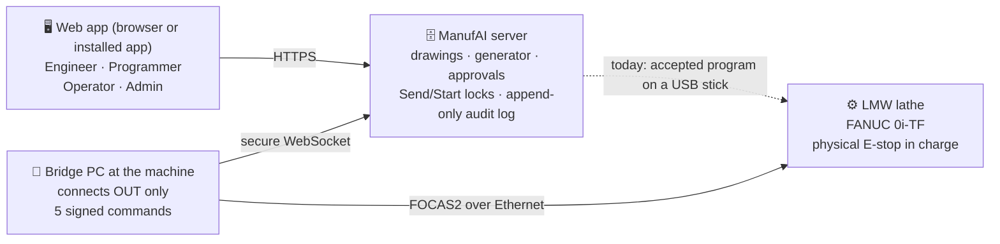

<div align="center">

# SDEW: manuf AI

### From a turned-part drawing to one machined piece on a CNC lathe, with every step checked

**ManufAI** is shop-floor software for **LMW CNC lathes with the FANUC Series 0i-TF control**.
Upload a drawing, confirm its values, and ManufAI generates the FANUC program with fixed rules
learned from the company's proven programs (never AI). An engineer or programmer checks and accepts
it, and it goes to the machine by USB stick today, or over the network once the bridge is in.
Safety checks at every step, and a log of every action that nobody can edit.

`13 / 13 milestones built` · `11 / 11 steps live` · `581 automated tests passing` · `9 / 9 safety rules enforced and tested` · `6 LMW machines registered` · `5 company programs reproduced`

📄 **[User manual](docs/ManufAI_User_Manual.pdf)** · **[WiFi bridge guide](docs/ManufAI_WiFi_Bridge_Guide.pdf)** · **[Progress report](docs/ManufAI_Progress_Report.pdf)** · **[Day-1 go-live runbook](docs/go-live.md)**

</div>

> [!IMPORTANT]
> **Safety first.** The software never replaces the machine's physical emergency stop: the red
> E-stop on the machine is always in charge. The AI never writes or edits CNC programs: the
> generator is fixed code, and any edit on screen is saved as a new version that must be accepted
> again. Cycle Start is pressed at the machine by the operator. See
> [docs/safety-rules.md](docs/safety-rules.md).

---

## Contents

1. [Built as per the project documents](#1-built-as-per-the-project-documents)
2. [How it works](#2-how-it-works)
3. [The 11 steps from drawing to part](#3-the-11-steps-from-drawing-to-part)
4. [Roles and logging in](#4-roles-and-logging-in)
5. [Tour of the app, with screenshots](#5-tour-of-the-app-with-screenshots)
6. [Safety rules](#6-safety-rules)
7. [Milestones](#7-milestones)
8. [Getting started](#8-getting-started)
9. [Day 1: the first part (USB route)](#9-day-1-the-first-part-usb-route)
10. [Connecting the real machine](#10-connecting-the-real-machine)
11. [Tests and proof](#11-tests-and-proof)
12. [What is still waiting on factory data](#12-what-is-still-waiting-on-factory-data)
13. [Repository layout and documents](#13-repository-layout-and-documents)

---

## 1. Built as per the project documents

Everything has been built as the project documents specify. All 13 milestones of the build plan
are done, every safety rule is enforced in code with its own test, and every go-live check from the
design document has a tool. The documents also say **never to invent real-world data** (drawings,
machine limits, tool layout, speeds and feeds). Where that data is missing, the software keeps an
empty, clearly marked placeholder and lists it in [open-items.md](docs/open-items.md), exactly as
the documents require.

| Document | What it asks for | Status |
|---|---|---|
| [Build plan](docs/build-plan.md) | 13 milestones: repo, users and roles, machine register, material register, simulated FANUC, FOCAS driver, probe tool, bridge, programs and validator, tool path, run screen, feature table, capability check | ✅ All 13 done |
| [Safety rules](docs/safety-rules.md) | 9 non-negotiable rules, each enforced in code and tested | ✅ 9 / 9, each with tests |
| [Architecture](docs/architecture.md) | Server, web app and an outbound-only bridge at the factory | ✅ Built as described |
| Design document (Nov 3, 2026) | The 11-step flow, roles, run log and go-live checks | ✅ 11 of 11 steps live: two AI agents read every uploaded drawing, and the program generator writes the program from that table |
| [Deployment](docs/deployment.md) | Production setup: HTTPS, PostgreSQL, first admin, health checks, backups, upgrades | ✅ Two ways: one Windows PC (`start-production.ps1`) or Docker with HTTPS |
| [Go-live runbook](docs/go-live.md) | Day 1: the first part (3773480M01) on LMW SMARTURN 55-04927 by USB stick | ✅ Ready |
| [FOCAS notes](docs/focas-notes.md) | What to verify on the real 0i-TF on the first day | ✅ Probe tool ready; checks happen at the machine |
| [Open items](docs/open-items.md) | Every input still needed from the factory | 📋 Drawings, nameplates and the generator are done; the network send still waits on the FOCAS library, the bridge PC and its token |

---

## 2. How it works



Until the FOCAS library and the bridge PC are in place, the accepted program is downloaded as
`O1000.NC` and loaded at the machine from a USB stick. The download has the same approval gate as
sending.

| Part | What it does | Runs on |
|---|---|---|
| **Web app** (`web/`) | The screens for every role. React, TypeScript and Tailwind. Works on a PC or a tablet at the machine, and can be installed as an app from Chrome or Edge. | Any browser |
| **Server** (`server/`) | Users and roles, machines, materials, drawings, the program generator, programs, parts, runs and the audit log. Checks every lock (who may send, who may start) on the server side, so a hidden button can't be bypassed. FastAPI, SQLAlchemy, Alembic, PostgreSQL or SQLite. Also serves the built web app on a single port. | One Windows PC, factory server or cloud |
| **Bridge** (`bridge/`) | Small service next to the machine. It dials **out** to the server and never opens a port. It accepts only `send_program`, `start`, `feed_hold`, `stop` and `read_status`, each signed and valid for 10 seconds. It talks to the CNC through FANUC FOCAS2, or to a built-in simulated 0i-TF. | Factory PC (Windows or Linux) |

---

## 3. The 11 steps from drawing to part

| # | Step | Who | Status |
|:-:|---|---|---|
| 1 | Upload the drawing | Engineer | ✅ Live |
| 2 | Read the drawing into a feature table | ManufAI | ✅ Live: every uploaded drawing is read by two AI agents through the Anthropic API (nothing is filled from stored values) |
| 3 | Confirm or correct every value in the feature table | Engineer | ✅ Live |
| 4 | List machines that can make the part and are online and idle | ManufAI | ✅ Live |
| 5 | Select the machine | Engineer | ✅ Live |
| 6 | Build the CNC program from the table (fixed code, never AI) | ManufAI | ✅ Live: generator built from the proven programs' tools, speeds and feeds, including the second clamping |
| 7 | Check, correct if needed, and accept the program | Engineer or programmer | ✅ Live |
| 8 | Confirm raw material and the safety checklist | Operator | ✅ Live |
| 9 | Send the program to the machine | Operator | ✅ USB stick today; network send tested on the simulated lathe |
| 10 | Start, Feed hold and Stop, with live status | Operator | ✅ Live, tested on the simulated lathe |
| 11 | Measure the first piece and record Pass or Fail | Operator | ✅ Live |

---

## 4. Roles and logging in

On the login page you **tap your role** instead of typing a username. **Other user** is there for
named accounts. In production the login page shows personal sign-in only.

| Role | What they do |
|---|---|
| **Engineer** | Uploads the drawing, confirms the feature table, picks the machine, generates, corrects and accepts the program |
| **Programmer** | Imports, checks, corrects and approves CNC programs; reads validator warnings and the tool path; the only role that can reject |
| **Operator** | Runs the part: material, checklist, send, start, first-piece result. Only people on the **Allowed to press Start** list can press Start. |
| **Admin** | Users and the Start list, bridges, audit log |

A person can have more than one role. The server checks the role again on every request.

### Demo accounts

Demo mode creates one account per role. **These passwords are public, for demos only.**

| Username | Password | Role | Allowed to press Start |
|---|---|---|:-:|
| `operator` | `qwerty` | operator | ✅ |
| `engineer` | `qwerty` | engineer | – |
| `programmer` | `qwerty` | programmer | – |
| `admin` | `qwerty` | admin | – |

> [!WARNING]
> In production, demo data is refused at start-up and no users exist until you create the first admin
> (see [Getting started](#8-getting-started)).

---

## 5. Tour of the app, with screenshots

### 5.1 Home

Live counts (machines, approved programs, confirmed parts, open runs), a quick-start hero, big
buttons for what your role does, the machines' live status, the 11-step flow with a tick on each
step, and the latest runs. The E-stop reminder appears on every main screen.

- **Left sidebar**: every page, grouped by job (Production, Engineering, Admin). Admin pages only
  appear for admins.
- **Ctrl + K**: type where you want to go ("drawing", "run", "approve", "materials") and press Enter.
- **Accessibility menu** (person icon in the top bar): larger text, high contrast and reduced
  motion. Status is always written in words, never shown by colour alone, and everything works with
  the keyboard.
- **Toasts** confirm generate, accept and download.

### 5.2 Drawing to program

The main page for a new part. An animated step track shows where you are, and one **Do this now**
card shows the next action.

1. **Upload the drawing.** Every drawing, including one uploaded before or from the demo data, is
   read by two AI agents through the Anthropic API: one extracts every feature and a point-by-point
   contour in mm, the second checks each value against the drawing. Nothing is filled from stored
   values. The values are **not** confirmed: the engineer still checks and ticks every row.
2. **Confirm the table.** Rows after **Turn part around** are the second clamping, measured from the
   back face. Values a drawing does not give (bar size, drill) are standard choices with a note.
3. **Choose the machine** and **Generate live program.** The generator is fixed code that works from
   the confirmed table only; no stored program for the part is looked up. Cutting values come from
   the last saved setup, company-wide reference values from the proven programs, or standard shop
   values, each shown with its source. It writes the second clamping after `M30` for sequence
   search.
4. **Correct on screen if needed.** The G-code editor keeps colours and line numbers, marks changed
   lines in amber, and re-runs the validator and tool path as you type. **Reset to
   generated** undoes everything. Nothing is saved until you accept.
6. **Accept** (engineer or programmer). An edit is saved as v2 "edited from v1 by …", so the audit
   log shows who changed what. Then **Download O1000.NC for a USB stick**.

### 5.3 Programs: check, simulate, approve

The company's 5 trusted programs (O0001, O0002, O0003, O0004, O0009) are imported byte for byte with
their SHA-256 fingerprints. The generator reproduces their part-off positions exactly (O0001 Z-26.5,
O0002 Z-23.2, O0003 Z-32.4). Any approved program can be **downloaded for a USB stick**; the
download is refused unless it is the latest approved version.

**Validator** (fixed rules, no AI). Every line is checked against FANUC 0i-TF lathe rules:
- **Errors** block approval and sending: missing `%`, O-number header, brackets, unreadable
  characters, unknown G codes, no M30/M99 at the end, spindle speed above the machine limit, tools
  not in the tool list, missing `M99 P` targets.
- **Warnings** are shown with their line number: M00 stops, two operations in one program,
  machine-specific M codes, the same T code used for two tools, code after M30, numbers without a
  decimal point, G96 without a G50 clamp.
- The 5 trusted programs have **0 errors**. Their expected warnings are pinned in
  `server/tests/test_validator.py`.

**Approval is tied to the exact text.** A programmer can upload, approve, reject or retire a program.
The text is never changed in place: any edit (including in the on-screen editor) creates a new
version and retires the approved one, so an approval always belongs to one exact program text.

| Machining simulation | Tool path |
|---|---|
| Press **Play** to watch the bar being cut, block by block, at 1×, 2×, 5× or 10× speed. Drills, boring bars and parting tools are recognised from their names in the program comments. Each operation is shown on its own, because the part is re-clamped in between. | Every move drawn: Z horizontal, X as radius, rapid moves dashed, feed moves solid, one colour per tool. Drag the slider or click a line of the program to step through it. Supports G0–G3, G28/G30, G70–G72, G74/G83, G76, G90/G92/G94. |

> Both are visual aids made with fixed rules. They don't prove a program is safe and don't replace
> the approval.

### 5.4 Parts: the feature table and capability check

A part is a table of values: material grade, bar diameter, overall length, and an ordered list of
features (OD, bore, face, chamfer, radius, groove, thread, drill, cone/countersink, and a **Turn part
around** row for the second clamping), each with tolerances.
- Each value has an **AI value** column (filled by the AI reader) and a **Confirmed value**
  with a tick box.
- **Only an engineer can confirm** the table, and only when every value is entered and ticked.
- **Any later change clears the confirmation**, and the part's programs can't be sent until it is
  confirmed again.

**Capability check** (fixed rules): a machine is offered only if it is in service, the bar and part
fit its limits, its tool list covers every feature, and it is online and idle. **Unknown limits are
never treated as capable**, so a machine shows "unknown" until its limits and tools are entered.

### 5.5 Running a part

The run screen is made for the shop floor. A progress bar shows **Prepare & send → Start →
Running → First piece → Done**, one **"do this now"** card shows only the next allowed action with
big buttons, and every locked button explains why it is locked.

| ① Choose machine and program | ② Material and safety checklist |
|---|---|
| Machine tiles show live state. Only **approved** programs are listed. An unfinished run is offered as **Continue run #N**. | The bar is matched to what the part needs: matching bars are listed first (✓), and a wrong grade or size shows a red alert. **Send** unlocks only when all 6 checklist items are ticked. |

**Send is locked until** the checklist is complete, the program is approved for this exact machine,
version and text, the part's feature table is confirmed by an engineer, and the machine is online
and idle with no alarm and no emergency stop.

**Start is locked until** all of that holds, the verified program is selected on the machine, and
the user is on the **Allowed to press Start** list. When a machine has remote control off (the
default, and the setting for every real machine), the screen says **"Program sent. Press Cycle Start
at the machine."** and follows the run from the live status.

| ③ Running | ④ First piece |
|---|---|
| Live state, spindle speed, program, block and part count. **Feed hold** and **Stop** stay available, and Stop is labelled as a control reset, **not** an emergency stop. | The measurement list is **pre-filled** from the confirmed feature table, with min and max limits. Each value is marked **OK** or **OUT**, and the operator chooses **Pass** or **Fail**. |

⑤ **Done.** A passed first piece marks the program **proven** for that part, and **Run this program
again** starts the next one. **Full screen** hides the browser for a tablet at the machine. Every
step is written to the audit log and to the **Run log** (who, which program, which machine, when,
how it was started, the first-piece result).

### 5.6 Machines

The register lists every machine with its control, IP address, live status and limits. The six real
machines are created from their nameplates, all with the FANUC Series 0i-TF control:

| Machine | Type | Mfg. No. | IP |
|---|---|---|---|
| LMW LX20TL3 · L110-00542 | LX20TL3 | L110-00542 | not entered |
| LMW LX20TL3 · L110-00523 | LX20TL3 | L110-00523 | not entered |
| LMW LX20TL3 · L110-01461 | LX20TL3 | L110-01461 | not entered |
| LMW LX20TL3 · L110-01237 | LX20TL3 | L110-01237 | not entered |
| LMW SMARTURN · 55-04927 | SMARTURN | 55-04927 | 192.168.11.12 |
| LMW SMARTURN · 55-05566 | SMARTURN | 55-05566 | not entered |

- Values not on the nameplate (limits, tools, most IPs) stay empty and show "Not entered", never
  guessed. (The screenshots show "LMW Lathe 1", the placeholder kept only for demo mode and tests.)
- Admins edit details and limits; admins and programmers manage turret tools (station, `T0101`-style
  tool and offset, insert, nose radius).
- **Remote control** (Start, Feed hold and Stop from the screen) is **off by default** and must also
  be enabled in the bridge's own settings.

### 5.7 Raw materials

Search by grade (`en8` finds `EN8`) or diameter range. Admins and engineers can import the company
register from **CSV or Excel**:
1. Choose the file. The server reads the header row and suggests which column is grade, diameter,
   length, quantity and notes.
2. Change any mapping in the drop-downs, so your column names can be anything.
3. Choose **skip** or **update** for rows that already exist.
4. **Check** shows the result without saving; **Import** saves it and writes an audit entry.

Values like `Ø25`, `25 mm` and `25,5` are understood. The sample file
`samples/materials/raw-material-register.sample.csv` is marked SAMPLE DATA on every row.

### 5.8 Users, bridges and audit log

| Users and Start list | Bridges |
|---|---|
| Tick roles per person, and keep the separate **Allowed to press Start** list. | Register the bridge PC at the machine and see whether it is connected. Each bridge gets its own token and signing key, shown once. |

**Audit log**: every login, upload, generate, edit, approval, download, send, start and result, with
user, machine, program, program fingerprint and time, newest first. Entries **can't be edited or
deleted**: there is no API for it, the app blocks it, and database triggers block it too.

---

## 6. Safety rules

Each rule is enforced in code and covered by automated tests. Full details are in
[docs/safety-rules.md](docs/safety-rules.md).

| # | Rule | Proven by |
|:-:|---|---|
| 1 | The software is never an emergency stop, and no button claims to be one. | `web/tests/run.test.tsx`, `web/tests/App.test.tsx` |
| 2 | The AI never writes or edits CNC programs. | `test_program_sources_never_include_ai`, `test_ai_package_cannot_touch_programs` |
| 3 | A program is sent (or downloaded) only if the feature table is confirmed **and** the program is approved for this part, machine and exact text. | `test_approval_problem_rules`, bridge `test_hash_mismatch_rejected` |
| 4 | Start unlocks only with the checklist done, no alarm, the machine idle, the approved program loaded, and the user on the Start list. | `test_start_lock_conditions`, `test_each_checklist_item_is_required` |
| 5 | The bridge connects outward only and never listens on a port. | `test_server_url_must_be_outbound_websocket` |
| 6 | The bridge accepts only 5 signed commands; anything else is rejected and logged. | `test_action_allow_list_is_exact`, `test_actions.py` |
| 7 | Every action is logged, and the log is append-only. | `test_audit_log.py` |
| 8 | If the bridge loses the server it does nothing on its own; the screen shows stale or offline after 5 s. | `test_no_machine_action_while_server_unreachable` |
| 9 | Remote Start, Feed hold and Stop are off by default; the screen then says "Press Cycle Start at the machine". | `test_remote_control_disabled_by_default` |

Also enforced: **unknown machine limits never count as capable**, **real-world data is never
invented** (values not on a drawing are labelled with their source), **facts about one part are
never carried to another**, and **every write to a machine goes through one function** (check → log
→ act → log).

---

## 7. Milestones

| # | Milestone | What was built |
|:-:|---|---|
| M1 | Repo and dev setup | Server, web and bridge skeleton; one-command setup and test scripts |
| M2 | Users, roles and audit log | Login, 4 roles, Allowed to press Start list, append-only log with database triggers |
| M3 | Machine register | Machines, limits and turret tools; unknown values stay empty |
| M4 | Raw material register | Search, add and edit, CSV/Excel import with column mapping |
| M5 | Simulated FANUC 0i-TF | A machine that behaves like the real control, for testing without the lathe |
| M6 | FOCAS2 driver | Real-machine driver, tested against a fake library until the machine is available |
| M7 | FOCAS probe tool | Step-by-step checks for the first day at the machine |
| M8 | Bridge service | Outbound link, live status every second, signed commands |
| M9 | Programs and validator | Import, versions, approval tied to the exact text, FANUC lathe rule checks |
| M10 | Tool path simulation | Every move of a program drawn and steppable |
| M11 | Run screen | Material, checklist, send, start, live status, first piece |
| M12 | Feature table | Part values with engineer confirmation |
| M13 | Capability check | Which machines can make the part, with reasons |

**Added after the plan:**
- **Drawing to program**: drawing upload, two-agent AI reading through the API, live generator
  working from the AI-read table, second clamping, cone/countersink and taper features, on-screen
  G-code editor, accept, USB download.
- **Real machines**: six LMW lathes from their nameplates.
- **One-PC production**: `start-production.ps1`, auto-start and nightly backup, installable app.
- From the design document: the run log, material length checks, a shift-long status watch, the
  machining simulation, the redesigned shop-floor UI and accessibility settings.

---

## 8. Getting started

**You need:** Python 3.11+ and Node.js 20+ (22 recommended). Docker is only needed for the Docker
options.

### Production on one Windows PC (recommended to start)

One PC runs ManufAI on one port; other laptops and tablets open it in a browser over Wi-Fi or the
office network.

```powershell
.\scripts\setup.ps1                     # once: installs what the app needs
.\scripts\start-production.ps1          # start (first time: builds the app, asks for the first admin)
.\scripts\install-autostart.ps1         # start with Windows, back up every evening at 20:00
.\scripts\start-production.ps1 -Rebuild # after updating the code
```

- The first run builds the web app, makes a secret key, creates the database, adds the six machines
  and asks for the first admin (password of 10+ characters). It prints the address to open, for
  example `http://192.168.1.25:8080`.
- Data, the secret key and backups live in `%LOCALAPPDATA%\ManufAI`, **never in OneDrive** (syncing a
  live database can corrupt it). Copy one backup to a pen drive every week.
- Run it once "as administrator" so the firewall lets other laptops in.
- **Install as an app:** open the address in Chrome or Edge and choose **Install ManufAI**.

### Production with Docker (several sites, HTTPS, PostgreSQL)

Use **`docker-compose.prod.yml`** and follow **[docs/deployment.md](docs/deployment.md)**. It covers
installation, the first admin, the bridge, health checks (`/api/health`, `/api/ready`), backups,
upgrades and the security checklist. The server refuses unsafe production settings at start-up.

```bash
docker compose -f docker-compose.prod.yml --env-file .env.prod up -d --build
```

### Development: full stack in Docker (server + PostgreSQL + web)

```bash
cp .env.example .env          # Windows PowerShell: Copy-Item .env.example .env
docker compose up --build
```

| What | Address |
|---|---|
| Web app | http://localhost:5173 |
| API health | http://localhost:8000/api/health |
| API docs | http://localhost:8000/docs |

The server applies database migrations automatically on start.

### Development without Docker (SQLite)

<details>
<summary><b>Windows (PowerShell)</b></summary>

```powershell
.\scripts\setup.ps1                                  # creates .venv, installs Python + npm deps, copies .env
cd server; ..\.venv\Scripts\alembic upgrade head
..\.venv\Scripts\uvicorn app.main:app --reload       # http://localhost:8000
# second terminal:
cd web; npm run dev                                  # http://localhost:5173
```
If PowerShell blocks scripts: `Set-ExecutionPolicy -Scope CurrentUser RemoteSigned`.
</details>

<details>
<summary><b>Linux / macOS</b></summary>

```bash
./scripts/setup.sh
cd server && ../.venv/bin/alembic upgrade head
../.venv/bin/uvicorn app.main:app --reload
# second terminal:
cd web && npm run dev
```
</details>

### First login (Docker)

By default the database holds **only real data**: the six LMW machines (unknown values empty). No
users exist until you create the first admin:

```bash
docker compose exec server python -m app.cli create-user YOURNAME --role admin --full-name "Your Name"
docker compose exec server python -m app.cli check
```

Add everyone else on the **Users** page. `python -m app.cli backup` makes an online SQLite copy with
an integrity check and a 30-day clean-up.

### Demo mode (development only)

```bash
MANUFAI_SEED_DEV_DATA=true docker compose --profile demo up --build
```

This adds the simulated bridge, a fictional **SIM Lathe**, the placeholder **LMW Lathe 1** with the 5
trusted programs, the demo program O9000, the DEMO-SIM-001 feature table, sample materials and the
[demo accounts](#demo-accounts). It is refused when `MANUFAI_ENV=production`. Without Docker: set
`MANUFAI_SEED_DEV_DATA=true` in `.env`, then run `cd server; ..\.venv\Scripts\python -m app.seed`.

**Try a full run:**
1. Log in as **operator**.
2. Go to **Run → SIM Lathe (dev - simulated) → O9000 → Start a run**.
3. Choose the material, tick the checklist, **Send program**, then **Start**.
4. Wait for *completed* and record the first piece.

**Try drawing to program:** log in as **engineer**, open **Drawing to program** and upload
a drawing PDF (the PDFs are not stored in this repo). Paste your Anthropic API key on the page
first; the two AI agents then read the drawing.

---

## 9. Day 1: the first part (USB route)

The full runbook is **[docs/go-live.md](docs/go-live.md)**. In short:

1. **Drawing to program → Upload** `3773480M01 SLEEVE 4WD.pdf`; check and tick every row, measure the
   bar on the rack, **Confirm table**.
2. Choose **LMW SMARTURN · 55-04927 → Generate live program**, compare with the proven O0001 (same
   tools T0101 drill, T0202 rough, T0303 finish, T0707 bore, T0404 parting; part-off at Z-26.5;
   second side from N6), read every note, **Accept program**.
3. **Download O1000.NC** and load it at the machine from the USB stick.
4. Dry run, then the first piece in single block. Turn the part around, set Z0 on the back face,
   sequence search **N6** for the second clamping.
5. Measure every dimension against the drawing. Not good → stop, fix, generate again (a new
   version must be accepted again).

**Stop at once** on any alarm, unexpected move, tool not where expected, or a value on the screen
that differs from the drawing. Nothing in the app overrides the operator's judgement.

---

## 10. Connecting the real machine

The step-by-step guide with photos is the **[WiFi bridge guide (PDF)](docs/ManufAI_WiFi_Bridge_Guide.pdf)**.

### First day at the machine (probe tool)

Goal: prove the factory PC can talk to the FANUC 0i-TF over FOCAS2 **before** connecting ManufAI.

**Bring:** the factory PC with this repo and `.venv`, the FANUC FOCAS library (`Fwlib64.dll` and its
companion DLLs, from FANUC or the machine supplier), an Ethernet cable, and someone allowed to change
CNC settings.

1. **At the CNC:** check Embedded Ethernet is enabled; note the IP address, subnet and FOCAS port
   (default 8193). Put the PC on the same subnet. Make sure the machine is idle with no alarm.
2. **Read-only probe** (changes nothing on the machine):
   ```powershell
   .venv\Scripts\python bridge\tools\focas_probe.py --ip 192.168.x.x --port 8193 --lib C:\manufai\fwlib\Fwlib64.dll
   ```
   Expect PASS for: TCP connect, open FOCAS handle, read status, program and sequence number, list
   programs. Write down the program list.
3. **Save a program** from the CNC and compare it with `samples/programs/O0001`:
   ```powershell
   .venv\Scripts\python bridge\tools\focas_probe.py --ip ... --lib ... --upload O0001 --out O0001_from_cnc.nc
   ```
4. **Write test** (only with the programmer's OK, the machine idle, no alarm, and the program-protect
   key off). Pick a number that is **not** used on the CNC (for example O9001). The tool refuses
   existing numbers and asks you to type `WRITE O9001`. It then sends, reads back, compares and
   deletes the program 20 times:
   ```powershell
   .venv\Scripts\python bridge\tools\focas_probe.py --ip ... --lib ... --roundtrip samples\demo\O9000 --number O9001
   ```
5. Work through the `VERIFY ON MACHINE` list in [docs/focas-notes.md](docs/focas-notes.md) and record
   the answers.

To practise without a machine, add `--simulate` (a simulated 0i-TF with the 5 trusted programs).
**If step 1 fails**, check power, cable, IP/subnet, port and the PC firewall. **If step 2 says "FOCAS
library not found"**, the `--lib` path is wrong, or a 32-bit DLL is being used with 64-bit Python.

### Go-live checks (from the design document)

| Check | How |
|---|---|
| WiFi signal at the machine, with the machine running | Maintenance/IT with a WiFi survey tool |
| The bridge PC can reach the CNC | `focas_probe.py --ip <cnc ip> --lib <Fwlib>` (steps 1–2) |
| A test program sends and returns intact 20 times in a row | `focas_probe.py ... --roundtrip FILE --number O9001` |
| Status reads stay steady for a full shift | `focas_probe.py ... --watch 480` (read-only; PASS means no failed read) |

### Installing the bridge on the factory PC

1. Copy `bridge/config.example.yaml` to `config.yaml`.
2. Fill in the server URL, the token and signing key (from **Admin → Bridges**), the machines and
   `focas_library_path`.
3. Check it: `manufai-bridge --config config.yaml --check`.
4. Run it as a service: on Windows with NSSM
   ([bridge/deploy/install-windows-service.md](bridge/deploy/install-windows-service.md)), on Linux
   with systemd (`bridge/deploy/manufai-bridge.service`). The PC clock must be NTP-synced.

The bridge pushes status every second and a heartbeat every 2 seconds. It rejects commands that are
unsigned, older than 10 seconds, replayed, for an unknown machine, or for a program whose fingerprint
doesn't match. If the link drops, it takes no machine action and reconnects by itself.

In demo mode you can watch this: `docker compose stop bridge` turns the machine badge **Offline**
within a second, and `docker compose start bridge` brings it back. A status older than 5 seconds
shows **Stale**.

---

## 11. Tests and proof

One command runs every linter and test suite:

```bash
./scripts/test.sh         # Linux / macOS / Git Bash
.\scripts\test.ps1        # Windows PowerShell
```

Latest run (15 Nov 2026): **581 tests passed.**

| Part | Checks | Result |
|---|---|---|
| Server | ruff · black · mypy · pytest | ✅ 370 passed, 6 skipped* |
| Bridge | ruff · black · mypy · pytest | ✅ 97 passed |
| Web app | eslint · TypeScript · vitest · production build | ✅ 114 passed |

<sub>*The skipped tests are the role check on public pages (login, health), which have no role by design.</sub>

The generator tests (`server/tests/test_generator.py`) generate programs from recorded tables of
the company's drawings (test data only, never used by the app) and check the second clamping, the
tolerance-middle cuts and that no stored program is used for a part.

---

## 12. What is still waiting on factory data

Done since the start: drawings of the five lathe parts, machine types and serial numbers from the
nameplates, the IP of 55-04927, the program generator (including the second clamping), and bar
stock versus cut blank per part. The rest is listed in full in
[docs/open-items.md](docs/open-items.md):

| Needed | Items | From |
|---|---|---|
| **Network send (blocking)** | FANUC FOCAS library (`Fwlib32.dll`), a bridge PC on the machine network, its bridge token | FANUC / LMW, IT |
| **Factory network** | Machine-only WiFi/VLAN with fixed IPs, signal survey, time sync; IPs of the other five machines | IT, maintenance |
| **Machine data** | Nameplate limits, turret tool layout and offsets, LMW-specific M codes, parameter 3401 | Shop floor, programmer |
| **Programmer checks** | The three notes marked **CHECK WITH THE PROGRAMMER** (1816C01001, 1627C00501, 3216C11701), where the proven program and the drawing differ | CNC programmer |
| **Sign-off** | Checklist wording, names allowed to press Start, PMC address for remote Start (may never be possible) | Production head |

**Next steps, in order:**
1. Day 1: the first part 3773480M01 on SMARTURN 55-04927 by USB stick ([go-live.md](docs/go-live.md)).
2. Get the FOCAS library and set up the bridge PC to send over the network.
3. Enter the turret tool lists and machine limits on the Machines page.
4. Programmer clears the three CHECK notes; run the next parts.

---

## 13. Repository layout and documents

```text
├── server/              FastAPI server: API, database, drawings, program generator, approvals, run control, audit log, validator and backplot
├── web/                 React web app: every screen (installable as an app)
├── bridge/              Factory-PC bridge: FOCAS2 driver, simulated 0i-TF, probe tool, service files
├── samples/
│   ├── programs/        The 5 trusted FANUC programs supplied by the company
│   ├── drawings/        Hand-checked tables: test data and AI accuracy scoring only
│   ├── demo/            O9000, a synthetic demo program for the simulator only
│   └── materials/       Sample material register (SAMPLE DATA)
├── docs/                Build plan, safety rules, architecture, deployment, go-live, FOCAS notes, open items, PDFs
├── scripts/             Setup, test, one-PC production, auto-start and backup scripts
├── docker-compose.yml        Development stack
└── docker-compose.prod.yml   Production stack with HTTPS
```

| Document | About |
|---|---|
| [docs/ManufAI_User_Manual.pdf](docs/ManufAI_User_Manual.pdf) | User manual for every role, with screenshots |
| [docs/ManufAI_WiFi_Bridge_Guide.pdf](docs/ManufAI_WiFi_Bridge_Guide.pdf) | Connecting a lathe over WiFi with the bridge PC |
| [docs/go-live.md](docs/go-live.md) | Day-1 runbook: the first part by USB stick |
| [docs/build-plan.md](docs/build-plan.md) | The plan and its 13 milestones (source of truth) |
| [docs/safety-rules.md](docs/safety-rules.md) | Each safety rule, where it is enforced and its tests |
| [docs/architecture.md](docs/architecture.md) | How the server, web app and bridge fit together |
| [docs/deployment.md](docs/deployment.md) | Production installation and operation |
| [docs/focas-notes.md](docs/focas-notes.md) | FANUC FOCAS2 details to verify on the real machine |
| [docs/open-items.md](docs/open-items.md) | Every input still needed from the factory |
| [docs/ManufAI_Progress_Report.pdf](docs/ManufAI_Progress_Report.pdf) | 7-page progress report with screenshots |
